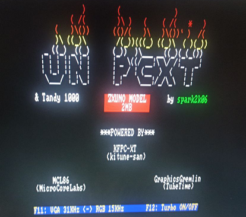

# IBM PC/XT core for Karabas Go / Mini / Mini G

An [IBM PC/XT](https://en.wikipedia.org/wiki/IBM_Personal_Computer_XT) for the Karabas Go, Karabas Mini and Karabas Mini G boards (Xilinx Spartan-6 XC6SLX25). It grew from [PCXT_Xilinx_Spartan_6](https://github.com/spark2k06/PCXT_Xilinx_Spartan_6) by [@spark2k06](https://github.com/spark2k06/), the Spartan-6 port of [PCXT_MiSTer](https://github.com/MiSTer-devel/PCXT_MiSTer). Fixes and features of PCXT_MiSTer were ported from there (see [docs/UPSTREAM.md](docs/UPSTREAM.md)).

## Features

- 8088 CPU: the MCL86 of PCXT_MiSTer 2026, with the instruction timing of an 8088; Turbo drops the timing and runs as fast as the bus allows.
- KFPC-XT chipset: 8259 PIC, 8253 PIT, 8255 PPI, 8237 DMA, 8288.
- 640 KB RAM, UMB and EMS (segment C000h) in the board SRAM.
- CGA (Graphics Gremlin): VGA output on Go, HDMI on Mini / Mini G; RGB (15 kHz) or VGA (scandoubled) mode.
- Sound: PC speaker, Adlib (JTOPL2), Tandy (SN76489); I2S DAC on Go / Mini G, sigma-delta on Mini, HDMI audio.
- MIDI OUT: an MPU-401 in UART mode at 330h to the MIDI synthesizer of the board.
- Hard disks: XTIDE BIOS, the CF card of the board and up to two disk images on the SD card.
- Floppy disks: two drives (A, B), 160K to 2.88M images on the SD card.
- USB keyboard (XT scancodes from the MCU) and USB mouse as a serial mouse on COM1 (CTMOUSE in `hdd/`).
- Real time clock of the board at ports 2C0h / 2C1h (`GET_RTC.EXE` in `hdd/` sets the DOS date and time).
- BIOS: Sergey Kiselev's XT BIOS 1.0.0a (1.44M floppies), loaded from the core file; another BIOS needs only a new core file (see Build).

## OSD (Menu+Esc)

Item | Hotkey | Values
---- | ------ | ------
Video mode | Menu+F11 | RGB / VGA
Turbo | Menu+F12 | Off / On
HDD0 | | CF card / Image
HDD0 image | Menu+F1 | `.img .vhd .hdf .bin .raw`
HDD1 image | Menu+F2 | `.img .vhd .hdf .bin .raw`
FDD A image | Menu+F3 | `.img .ima .dsk .vfd .flp`
FDD B image | Menu+F4 | `.img .ima .dsk .vfd .flp`
Reset | Ctrl+Alt+Del | resets the whole PC

With HDD0 = CF card, the CF card is drive 0 and the HDD1 image drive 1; with HDD0 = Image, the two images are drives 0 and 1.

## Build

ISE 14.7 on Linux (`/opt/Xilinx/14.7/ISE_DS/settings64.sh`), in `src/`:

    make minig        # Mini G: karabas_minig_top.bin, pcxt.kg3
    make mini         # Mini:   karabas_mini_top.bin,  pcxt.kg2
    make go           # Go:     karabas_go_top.bin,    pcxt.kg1
    make minig-core   # repack pcxt.kg3 only (core_minig.json: build number, BIOS)

The submodule `modules/` (karabas-go-modules) is needed: clone with `--recursive` or run `git submodule update --init`. `make_core.py` is a link into `karabas-go-tools`, which must sit next to this repository. The BIOS and the XTIDE BIOS of the core file are the `roms` of `core*.json` (`src/rom/`).

Simulations (iverilog) in `src/sim/`: `run_cpu_sim.sh` (CPU flags), `run_disks_sim.sh` (XTIDE + disk images), `run_fdd_sim.sh` (floppy images), `run_dma_sim.sh` (floppy DMA), `tb_mpu401.v` (MIDI).

## Layout

- `src/`: the build (Makefile, tops, ucf, prj, `core*.json`, `config.vh`, the cores `pcxt.kg*`), `rtl/`, `sim/`, `rom/`.
- `src/rtl/`: `karabas_pcxt.v` (the machine of the three tops: MCU link, OSD, disks), `system.v` (the PC), `cpu/`, `chipset/`, `video/`, `sound/`, `uart/`, `common/`, `hdmi/`, `mouse/`.
- `modules/`: karabas-go-modules (MCU link, OSD overlay, disk images, HDMI, DACs).
- `SW/`: BIOS sources and ROM images, the splash screen. `hdd/`: DOS tools. `docs/`: the plan of the port, the inventory of PCXT_MiSTer commits.

## Credits and licenses

The core is GPL v3 (LICENSE.txt); its parts keep their own licenses.

- [MCL86](https://github.com/MicroCoreLabs/Projects/tree/master/MCL86) by Ted Fried ([@MicroCoreLabs](https://github.com/MicroCoreLabs/)), the 2026 version by Marcus Andrade (opengateware), MIT.
- [KFPC-XT](https://github.com/kitune-san/KFPC-XT) by [@kitune-san](https://github.com/kitune-san), MIT.
- [Graphics Gremlin](https://github.com/schlae/graphics-gremlin) by TubeTimeUS ([@schlae](https://github.com/schlae)).
- [JTOPL](https://github.com/jotego/jtopl) by Jose Tejada ([@topapate](https://github.com/jotego)), GPL v3.
- SN76489AN compatible implementation by [Arnim Laeuger](https://github.com/devsaurus).
- The floppy controller of ao486 (Aleksander Osman, Alexey Melnikov), BSD, as in PCXT_MiSTer.
- PCXT_MiSTer and PCXT_Xilinx_Spartan_6 by [@spark2k06](https://github.com/spark2k06/) and contributors.
- XT BIOS by Sergey Kiselev; XTIDE Universal BIOS.
